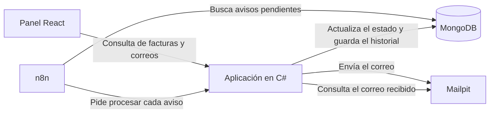

# Control de facturas

**Documento de arquitectura para Monolegal**

La aplicación revisa qué facturas tienen un recordatorio pendiente, envía el correo correspondiente y registra el cambio de estado. El panel permite consultar las facturas y abrir cada aviso desde su historial. La demo incluye seis facturas de tres clientes ficticios.

[Panel privado de revisión](https://angelszs.site/facturas/) · [Repositorio privado](https://github.com/Ahgarzon/facturas-recordatorios) · [Guía de despliegue](DESPLIEGUE.md)

## 1. Prueba guiada con FAC-0104

En la demo alojada, el flujo **Facturas · Procesar recordatorios** procesó la factura de Estudio Páramo por **COP 122.000**. Mailpit recibió su aviso el **26 de noviembre de 2026 a las 13:58**, hora de Colombia, y la factura pasó de **Primer recordatorio** a **Segundo recordatorio**.

1. Entra al [panel de revisión](https://angelszs.site/facturas/) con las credenciales compartidas. En **Facturas**, abre **FAC-0104** y comprueba que figure **Segundo recordatorio**.
2. Busca **Historial de avisos** en el detalle de la factura y pulsa **Ver correo en bandeja**. El asunto es **Segundo recordatorio de tu factura · FAC-0104** y el destinatario ficticio es `paramo@facturas.example.invalid`.
3. Lee el mensaje y vuelve a **Correos de prueba**. El aviso debe aparecer como **Leído**. El identificador del correo coincide con el que muestra el historial de la factura.

> La bandeja es compartida. Si otra persona ya abrió el correo, aparecerá como **Leído** y podrás volver a abrirlo para comprobar el contenido.

## 2. Cómo funciona

1. **n8n encuentra los avisos pendientes.** Consulta las facturas en MongoDB y le pide a la aplicación en C# que procese cada aviso.
2. **La aplicación envía el correo y registra el cambio.** Vuelve a comprobar que el aviso esté pendiente y reserva la factura para evitar que dos ejecuciones la procesen a la vez. Cuando Mailpit acepta el correo, guarda el nuevo estado y el aviso en el historial.
3. **El revisor abre el aviso en el panel.** El panel muestra el correo guardado en Mailpit. Se puede abrir desde la factura o desde **Correos de prueba**.

| Estado antes del aviso | Estado después del envío |
| --- | --- |
| Primer recordatorio | Segundo recordatorio. El siguiente aviso queda programado para 24 horas después. |
| Segundo recordatorio | Desactivado. La factura queda sin avisos pendientes. |

> Si el envío falla de forma confirmada, la factura conserva su estado y puede volver a intentarse. Si queda duda de si el correo se envió, el caso se reserva para revisión antes de volver a intentarlo.

## 3. Despliegue y comprobaciones

### Revisar la demo o ejecutarla desde cero

El panel alojado permite revisar el aviso ya procesado. Para generar uno nuevo con la misma factura, instala la demo en tu propia instancia con Docker Compose. La guía incluye los comandos de arranque y el paso para adelantar solo el recordatorio de **FAC-0104**. [Repetir FAC-0104 en una instancia propia](DESPLIEGUE.md#repetir-fac-0104-en-una-instancia-propia)

### Qué se comprobó

Las **18 pruebas unitarias** cubren cambios de estado, fallos de envío, ejecuciones simultáneas y acceso a los correos de prueba. Una prueba de integración ejecuta el flujo con los tres clientes, abre un aviso recibido y comprueba que repetir la ejecución de inmediato conserva la cantidad de correos. [Pruebas unitarias](../tests/Facturas.Tests/) · [Ejecución en GitHub Actions](https://github.com/Ahgarzon/facturas-recordatorios/actions/runs/45879713796)

La solución se abre en **Visual Studio**. El código de C# recibe la base de datos y el servicio de correo mediante inyección de dependencias. Eso permite probar las reglas de recordatorio sin conectarse a un buzón real. La secuencia y los plazos de los avisos se cambian en el archivo de configuración de la política. [Código de la aplicación](../src/Facturas.Api/) · [Política de avisos](../src/Facturas.Api/reminders.json)

### Qué haría falta para enviar correos reales

La demo usa Mailpit como bandeja de prueba. Para entregar a un buzón real, se necesita un proveedor de correo con conexión autenticada y cifrada, un remitente autorizado y un destinatario real aprobado. Las credenciales se configuran en el servidor. La marca **Leído** del panel registra la apertura en la bandeja de prueba. [Guía de conexión](DESPLIEGUE.md#conectar-un-buzón-real)
