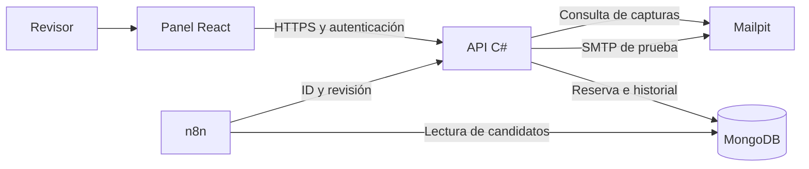

# Control de facturas

**Documento de arquitectura para Monolegal**

Aplicación de revisión de facturas y recordatorios. El equipo evaluador puede seguir un mismo aviso desde el cambio de estado en MongoDB hasta su recepción y apertura en Mailpit. La demo usa seis facturas de tres clientes ficticios.

[Panel privado de revisión](https://angelszs.site/facturas/) · [Repositorio privado](https://github.com/Ahgarzon/facturas-recordatorios) · [Guía de despliegue](DESPLIEGUE.md)

## 1. Arquitectura y alcance

React presenta el resumen de facturas y la bandeja de correos de prueba. n8n orquesta el trabajo. La API de .NET 10 en C# verifica la elegibilidad, aplica la política de estados y registra el resultado. MongoDB conserva la evidencia y Mailpit recibe los mensajes por SMTP.



| Componente | Responsabilidad |
| --- | --- |
| React y GitHub Pages | Lista y filtra facturas. Presenta el historial y permite abrir el aviso recibido. |
| n8n | Selecciona hasta 50 avisos vencidos con acceso de solo lectura a MongoDB. Devuelve un resultado por factura. |
| API C# y MongoDB | La API valida la revisión, reserva la factura y registra el cambio. La solución se abre en Visual Studio 2026. |
| Mailpit | Recibe los avisos por SMTP de prueba y conserva las capturas disponibles para la bandeja. |

> El panel recibe los datos del VPS por HTTPS. Las credenciales de revisión se entregan por separado. El flujo de n8n, su llave de ejecución y la administración de Mailpit pertenecen al entorno de operación.

## 2. Procesamiento y consistencia

| Estado elegible | Estado al aceptar SMTP | Próximo aviso |
| --- | --- | --- |
| `primerrecordatorio` | `segundorecordatorio` | 24 horas después, según la política inicial. |
| `segundorecordatorio` | `desactivado` | Sin fecha. `desactivado` es un estado terminal de la factura. |

1. **Selección.** n8n consulta `facturas.invoices` por fecha vencida y ausencia de un intento activo. Envía el identificador y la revisión a `POST /api/internal/reminders/{id}` con `X-Workflow-Key`.
2. **Reserva.** C# valida otra vez fecha, estado y revisión. MongoDB reserva el documento con un filtro condicional. Solo la ejecución que obtiene esa reserva intenta enviar el correo.
3. **Envío y registro.** MailKit envía el mensaje con un `Message-ID` derivado del identificador y la revisión de la factura. Al aceptar SMTP, una sola escritura cambia el estado, agrega la entrada al historial, incrementa la revisión y libera la reserva.
4. **Recepción y lectura.** La bandeja cruza el `Message-ID` de Mailpit con el historial y el destinatario ficticio. Al abrir el correo, la bandeja compartida registra **Leído**. Este paso conserva el estado de la factura.

| Incidencia | Respuesta |
| --- | --- |
| Rechazo SMTP confirmado | Conserva estado e historial. Libera la reserva y vuelve a hacer elegible la factura después de 15 minutos. Se procesa cuando vuelva a ejecutarse n8n. |
| Aceptación incierta o escritura fallida tras SMTP | Conserva la reserva para conciliación. Un intento detenido se muestra para revisión después de dos minutos. El operador puede buscar el `Message-ID` en Mailpit antes de intervenir. |

Cada documento guarda estado, próxima fecha, revisión, reserva activa e historial. El identificador del correo ayuda a conciliar dos sistemas con escrituras independientes. El diseño evita procesar a la vez la misma revisión y evita el reenvío automático cuando la aceptación es incierta. La política se edita en [reminders.json](../src/Facturas.Api/reminders.json).

## 3. Verificación con FAC-0104

**Resultado observado en la demo alojada.** n8n procesó una sola factura elegible. Mailpit capturó un correo que coincide con la entrada del historial.

| Dato | Evidencia |
| --- | --- |
| Factura | `FAC-0104` · Estudio Páramo · COP 122.000 |
| Transición | **Primer recordatorio → Segundo recordatorio** |
| Asunto | Segundo recordatorio de tu factura · FAC-0104 |
| Destinatario ficticio | `paramo@facturas.example.invalid` |
| Recepción y registro | 26 nov 2026, 13:58:31.982 y 13:58:32.035, respectivamente, hora de Colombia. |
| Identificador compartido | `factura-FAC-0104-0@facturas.example.invalid` |

1. Entra al [panel de revisión](https://angelszs.site/facturas/) con las credenciales compartidas. Abre **Facturas → FAC-0104** y comprueba el estado **Segundo recordatorio**.
2. En **Historial de avisos**, verifica el estado anterior y el identificador del mensaje. Pulsa **Ver correo en bandeja**.
3. Comprueba el destinatario, la hora de recepción y el cuerpo. Cierra el detalle y verifica **Leído** en **Correos de prueba**. También puedes encontrar el mismo aviso directamente por su asunto en esa sección.

> La lectura es compartida en Mailpit. Si el aviso ya figura como leído, puedes volver a abrir el contenido y comprobar el mismo vínculo con la factura.

## 4. Despliegue y reproducción

El despliegue separa el panel estático de la API alojada en Contabo. El proxy permite el origen exacto del panel y autentica las consultas. Las rutas de revisión exponen el resumen, las etiquetas y la bandeja vinculada. La ruta que ejecuta avisos usa una llave independiente de n8n.

### Ejecutar una instancia propia

Requisitos de la demo completa. Docker con Compose v2 y Node.js 22 o superior. Para abrir la solución y ejecutar pruebas de C# fuera de los contenedores, usa Visual Studio 2026 y el SDK de .NET 10.

```sh
node docker/create-env.mjs
docker compose up -d --build
docker compose run --rm n8n-setup
```

| Servicio local | Dirección |
| --- | --- |
| Panel y API | `http://127.0.0.1:18080` |
| Editor n8n | `http://localhost:15678` |
| Mailpit | `http://127.0.0.1:18025` |

Ejecuta estas comprobaciones en una instancia limpia que todavía tenga pendiente la primera corrida del flujo.

```sh
dotnet test ControlFacturas.sln
node scripts/verify-demo.mjs
```

La semilla local deja tres facturas elegibles y agenda `FAC-0104` para más adelante. Para generar el aviso de la sección 3 desde cero, completa la verificación inicial y sigue los [pasos para repetir FAC-0104](DESPLIEGUE.md#repetir-fac-0104-en-una-instancia-propia). El procedimiento adelanta solo la fecha de esa factura.

> El flujo admite ejecución manual. El disparador diario configurado es a las 8:15 a. m. de Colombia y opera cuando se publica. Las credenciales y los datos de la instancia se conservan fuera de Git.

## 5. Validación y conexión de correo real

| Criterio | Evidencia en el repositorio |
| --- | --- |
| Código y responsabilidades | [ReminderProcessor.cs](../src/Facturas.Api/ReminderProcessor.cs), [MongoInvoiceStore.cs](../src/Facturas.Api/MongoInvoiceStore.cs) y la política de recordatorios. |
| Inyección de dependencias | [Program.cs](../src/Facturas.Api/Program.cs) conecta la política, el reloj, el repositorio y el transporte. El procesador usa sus interfaces. |
| Pruebas unitarias | 18 pruebas de transiciones, elegibilidad, fallos, llamadas concurrentes sobre un repositorio de prueba y acceso a capturas. [Proyecto de pruebas](../tests/Facturas.Tests/) |
| Integración | Compose ejecuta n8n dos veces, comprueba tres envíos a Mailpit, la lectura y la ausencia de duplicados al repetir inmediatamente. [GitHub Actions](https://github.com/Ahgarzon/facturas-recordatorios/actions/runs/45879713796) |
| Frontend | Panel React y apertura del correo desde el historial, verificados en Chrome en escritorio y móvil. [Código del panel](../web/src/) |

### Envío a un buzón externo

La demo usa Mailpit. Un envío real requiere un proveedor SMTP autorizado, TLS, autenticación en el adaptador de C#, un remitente permitido y un destinatario real aprobado. Gmail admite OAuth 2.0 para SMTP. Un proveedor transaccional como Resend admite SMTP autenticado con un dominio verificado. Las credenciales se guardan fuera del repositorio. [Gmail OAuth 2.0](https://developers.google.com/workspace/gmail/imap/xoauth2-protocol) · [Resend SMTP](https://resend.com/docs/send-with-smtp)

La aceptación SMTP permite registrar que el servidor recibió el aviso. Un proveedor puede reportar entrega o rebote. Para una prueba de lectura real, el destinatario abre el mensaje en su buzón. La marca **Leído** del panel pertenece a la bandeja de prueba. [SMTP, RFC 5321](https://datatracker.ietf.org/doc/html/rfc5321#section-6.1) · [API de Mailpit](https://mailpit.axllent.org/docs/api-v1/)
